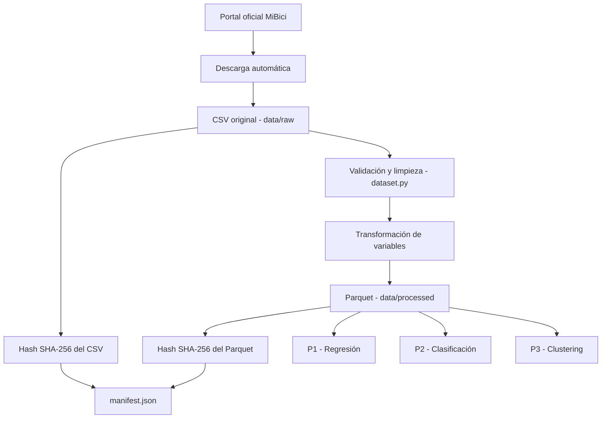

## TC5061 - Proyecto Equipo 17

### 1. Descripción general

Este proyecto utiliza datos abiertos del sistema de bicicletas
compartidas MiBici, que opera en el Área Metropolitana de Guadalajara,
Jalisco, México.

El conjunto de datos contiene registros de viajes realizados en el
sistema. Su análisis permite estudiar patrones temporales de uso,
duración de recorridos y relaciones entre estaciones.

El Equipo 17 utiliza estos datos como base común para desarrollar
tres problemas de aprendizaje automático:

- P1: Regresión.
- P2: Clasificación.
- P3: Clustering.

Las variables objetivo, unidades de análisis y estrategias de
evaluación de cada problema serán definidas y documentadas por
los responsables de cada modelo.

### 2. Fuente de los datos

**Organización:** MiBici Guadalajara.

**Portal oficial:**
https://www.mibici.net/es/datos-abiertos/

**Archivo seleccionado:** datos_abiertos_2025_01.csv

**Periodo:** Enero de 2025.

**URL de descarga directa:**
https://www.mibici.net/site/assets/files/97653/datos_abiertos_2025_01.csv

**Formato original:** CSV.

**Codificación utilizada para la lectura:** Windows-1252 (cp1252).

La descarga del archivo está automatizada en el módulo:

`tc5061_proyecto_equipo17/dataset.py`

### 3. Tamaño y características

Los siguientes valores se obtuvieron durante la ejecución
del pipeline del proyecto.

| Característica | Resultado |
|---|---|
| Periodo | Enero de 2025 |
| Tamaño descargado | 32,959,338 bytes |
| Tamaño aproximado | 31.43 MiB |
| Registros originales | 380,184 |
| Registros procesados | 379,979 |
| Registros descartados | 205 |
| Columnas originales | 8 |
| Columnas procesadas | 10 |
| Formato de salida | Parquet |
| Compresión | Snappy |

Los 205 registros descartados corresponden al efecto conjunto
de las reglas de limpieza: eliminación de identificadores de
viaje duplicados, exclusión de registros con campos esenciales
inválidos o faltantes y eliminación de duraciones no positivas.

El desglose exacto de descartes por causa todavía no se
registra individualmente en el pipeline.

### 4. Estructura original del CSV

| Columna original | Descripción |
|---|---|
| Viaje_Id | Identificador del viaje |
| Usuario_Id | Identificador del usuario |
| Genero | Género registrado |
| Año_de_nacimiento | Año de nacimiento registrado |
| Inicio_del_viaje | Fecha y hora de inicio |
| Fin_del_viaje | Fecha y hora de finalización |
| Origen_Id | Identificador de estación de origen |
| Destino_Id | Identificador de estación de destino |

### 5. Procesamiento y limpieza

El módulo `dataset.py` realiza las siguientes operaciones:

1. Comprueba si el CSV existe en `data/raw/`.
2. Si no existe, descarga el archivo desde la fuente oficial.
3. Verifica que el archivo descargado no esté vacío y que
   incluya las columnas obligatorias.
4. Lee el CSV utilizando la codificación `cp1252`.
5. Normaliza los nombres de columnas a `snake_case`.
6. Elimina registros duplicados según `viaje_id`.
7. Convierte las fechas de inicio y fin a tipo fecha-hora.
8. Convierte los identificadores de estaciones a valores
   numéricos enteros anulables.
9. Descarta registros con fechas o estaciones inválidas.
10. Calcula la duración de cada viaje en minutos.
11. Descarta viajes con duración menor o igual a cero.
12. Genera variables temporales adicionales.
13. Selecciona las columnas autorizadas para el dataset
    procesado.
14. Guarda el resultado en formato Parquet con compresión
    Snappy.
15. Genera un manifiesto JSON con metadatos y hashes SHA-256.

### 6. Variables del dataset procesado

| Variable | Descripción |
|---|---|
| viaje_id | Identificador del viaje |
| inicio_del_viaje | Fecha y hora de inicio |
| fin_del_viaje | Fecha y hora de finalización |
| origen_id | Identificador de estación de origen |
| destino_id | Identificador de estación de destino |
| duracion_minutos | Duración calculada en minutos |
| fecha | Fecha de inicio |
| hora | Hora de inicio, de 0 a 23 |
| dia_semana | Día de la semana, de 0 a 6; lunes = 0 |
| mes | Mes de inicio, de 1 a 12 |

### 7. Privacidad y tratamiento de datos

El CSV original contiene información que requiere un
tratamiento cuidadoso, especialmente:

- `Usuario_Id`
- `Genero`
- `Año_de_nacimiento`

Estas tres columnas se excluyen del dataset procesado.

El identificador `viaje_id` se conserva únicamente para
trazabilidad interna. Los horarios y estaciones también
requieren precaución, pues podrían revelar patrones de
movilidad al combinarse con otras fuentes.

Por ello:

- Los archivos CSV originales no se publican en GitHub.
- Los archivos Parquet procesados no se publican en GitHub.
- El repositorio comparte código y documentación.
- Los análisis públicos deberán evitar la divulgación de
  trayectorias individuales o información que permita
  identificar personas.
- Se recomienda utilizar resultados agregados cuando
  sea posible.

La exclusión de columnas identificadoras directas no
constituye por sí sola una garantía de anonimato.

### 8. Términos de uso y licencia

La fuente de datos es el portal público de MiBici.

**Estado de verificación:** pendiente de confirmar las
condiciones exactas de reutilización, atribución y
redistribución aplicables al archivo seleccionado.

No se atribuye al dataset una licencia específica hasta
verificarla en la documentación oficial.

Antes de publicar datos derivados o redistribuir archivos,
el equipo deberá revisar las condiciones vigentes del
proveedor.

### 9. Arquitectura del pipeline




Esta arquitectura establece una fuente de datos y una etapa
de preparación común para los integrantes del equipo.

Las transformaciones específicas de cada problema deberán
desarrollarse posteriormente, evitando introducir
información del conjunto de prueba durante el entrenamiento.

### 10. Reproducibilidad

El proyecto utiliza Python y dependencias registradas
en `requirements.txt` y `requirements-lock.txt`.

Para ejecutar el pipeline desde la raíz del proyecto,
con el entorno virtual activado:

```bash
python -m tc5061_proyecto_equipo17.dataset
```

El programa descarga el archivo oficial si todavía no
existe y después genera los resultados procesados.

**Archivo Parquet:**

`data/processed/datos_abiertos_2025_01_procesado.parquet`

**Manifiesto:**

`data/processed/manifest.json`

El manifiesto registra los hashes SHA-256 de los archivos
originales y procesados, el número de registros y las
columnas seleccionadas.

Estos hashes permiten comprobar la integridad de los
archivos, aunque no garantizan por sí solos que todas
las transformaciones sean correctas.

### 11. Limitaciones conocidas

- El dataset cubre únicamente enero de 2025.
- Los resultados pueden presentar estacionalidad.
- No se incorporan todavía variables meteorológicas,
  festivos ni información adicional de estaciones.
- El pipeline descarta viajes con duración no positiva,
  pero no aplica un límite máximo de duración.
- No se registra aún el desglose de descartes por causa.
- La validación de archivos existentes comprueba que
  no estén vacíos, pero no verifica automáticamente
  su hash frente a una referencia confiable.
- Los términos de reutilización deben verificarse.
- El manifiesto se genera localmente y no se publica
  junto con los archivos de datos.

### 12. Responsabilidad del equipo

**Rol 1: Datos e infraestructura**

Responsable de preparar y documentar la fuente común,
mantener el pipeline, gestionar las dependencias y
establecer las bases de reproducibilidad.

**Roles 2, 3 y 4**

Responsables de desarrollar y evaluar los modelos de
regresión, clasificación y clustering, respectivamente.

Los modelos deberán utilizar los datos comunes y
documentar cualquier transformación adicional.

