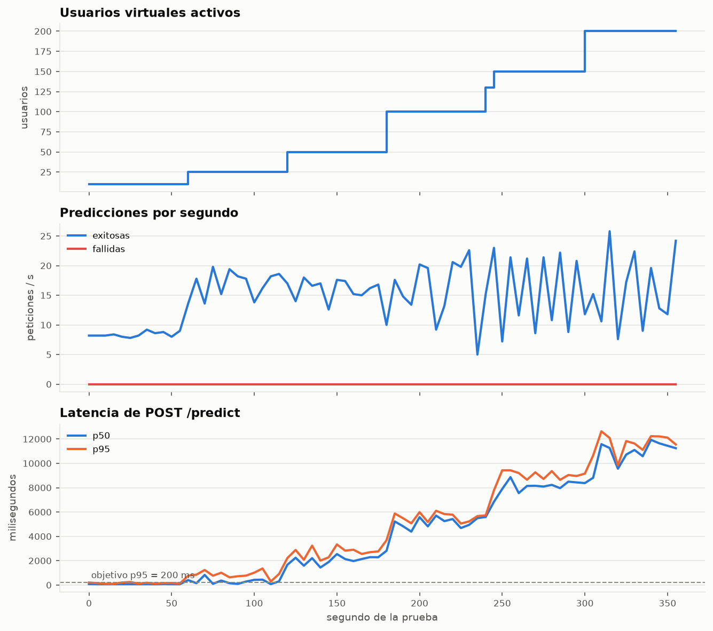
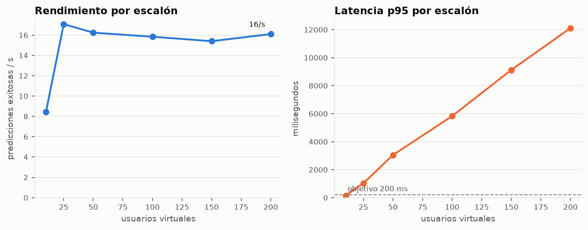
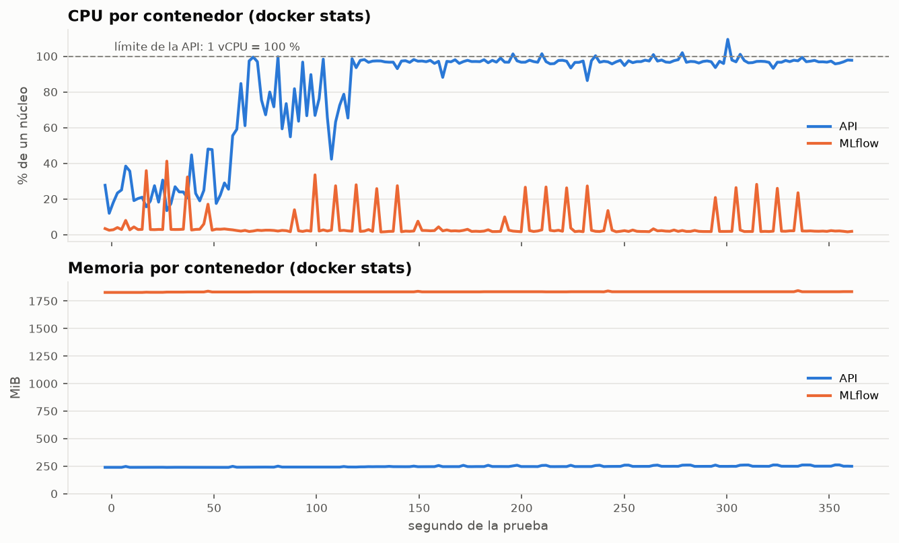

# Prueba de carga de la API P2 con Locust (Actividad 11)

Este documento describe el escenario de carga, los resultados y el consumo de recursos
del sistema levantado con `docker compose`. Las cifras alimentan el análisis FinOps
(`docs/finops_p2.md`): `reports/carga/resumen_carga.json` usa los mismos nombres de campo
que `reports/finops/parametros.json`.

## 1. Qué se probó

| Elemento | Valor |
|---|---|
| Sistema | `docker compose up` (rama `feat/docker-compose`): API FastAPI + servidor MLflow |
| Tamaño de la API | 1 vCPU y 1 GB (límites de `docker-compose.yml`) |
| Modelo | `mibici-equipo17-p2-riesgo@champion` (Random Forest, 100 árboles, profundidad 12) |
| Herramienta | Locust 2.47.0, sin interfaz, desde la misma máquina |
| Recursos | `docker stats` cada 2 s, en paralelo a la prueba |
| Máquina | Windows 11, Docker Desktop 29.8 (12 CPU y 8 GB asignados a Docker) |

### Escenario (`carga/locustfile.py`)

Cada usuario virtual representa a un operador del equipo de rebalanceo, o a un tablero,
que consulta el riesgo de estaciones con pausas de 0.5 a 1.5 s. Mezcla de peticiones:

| Petición | Peso | Por qué |
|---|---:|---|
| `POST /predict` con entrada válida | 90 % | Es la inferencia que se cobra. Las entradas son **1,000 filas reales** de la ventana 22–31 de julio de 2025 (`carga/payloads_p2.json`), no un mismo ejemplo repetido, para que el modelo recorra caminos distintos en sus árboles. |
| `POST /predict` con entrada inválida | 5 % | Comprueba que la validación de Pydantic responde 422 bajo carga. |
| `GET /` | 5 % | Comprobación de salud, como la de un balanceador o del healthcheck. |

Locust revisa el **contenido** de cada respuesta, no solo el código HTTP: una predicción
cuenta como fallida si `prediccion` no es 0 o 1, o si `probabilidad` no está entre 0 y 1.

La carga sube en **escalones de un minuto: 10, 25, 50, 100, 150 y 200 usuarios**, para
encontrar el punto en que la API deja de responder a tiempo. Los primeros 10 s de cada
escalón no se cuentan, porque los usuarios todavía se están creando.

**Objetivo de servicio (SLO):** p95 de `POST /predict` ≤ 200 ms y errores ≤ 1 %. Una
predicción de riesgo alimenta decisiones de la hora siguiente, pero un tablero que tarda
más de una fracción de segundo deja de sentirse interactivo.

## 2. Resultados

| Indicador (prueba completa) | Valor |
|---|---:|
| Duración | 359 s |
| Predicciones exitosas / fallidas | 5,312 / **0** |
| Rendimiento promedio | 14.8 predicciones/s |
| Latencia de `/predict`: p50 / p95 | 4,274 ms / 11,535 ms |
| Entradas inválidas respondidas con 422 | 294 de 294 (mediana 59 ms) |

### Por escalón (`reports/carga/resumen_etapas.csv`)

| Usuarios | Pred./s | p50 ms | p95 ms | p99 ms | Errores | CPU API | ¿Cumple SLO? |
|---:|---:|---:|---:|---:|---:|---:|:---:|
| 10 | 8.4 | 69 | 156 | 227 | 0 % | 26 % | sí |
| 25 | 17.1 | 218 | 1,038 | 1,297 | 0 % | 76 % | no |
| 50 | 16.2 | 1,995 | 3,049 | 3,309 | 0 % | 97 % | no |
| 100 | 15.8 | 4,981 | 5,828 | 6,104 | 0 % | 97 % | no |
| 150 | 15.4 | 8,230 | 9,126 | 9,490 | 0 % | 97 % | no |
| 200 | 16.1 | 11,289 | 12,111 | 12,325 | 0 % | 97 % | no |





### Interpretación

- **La API se satura entre 10 y 25 usuarios, en unas 16–17 predicciones por segundo.** A
  partir de 25 usuarios el rendimiento ya no sube: es un techo de capacidad, no de demanda.
- **Pasado el techo, la latencia crece en línea recta con los usuarios** (de 1 s a 12 s de
  p95). Las peticiones esperan en fila: con el doble de usuarios, la espera se duplica.
  Este es el comportamiento típico de un sistema limitado por CPU.
- **No hubo errores ni con 200 usuarios.** La API no se cae; se vuelve lenta. Para un
  usuario, una respuesta en 12 s equivale a una falla, por eso el SLO se mide en latencia
  y no solo en errores.
- **Capacidad sostenible con el SLO: ~8 predicciones/s (10 usuarios, p95 156 ms, CPU 26 %).**
  Entre 10 y 25 usuarios debe estar el punto óptimo; un escalón intermedio (15–20 usuarios)
  permitiría ubicarlo con más precisión.
- **La validación protege al modelo.** Las entradas inválidas se rechazan en ~60 ms aun con
  la API saturada, porque Pydantic responde 422 antes de llegar al Random Forest.

## 3. Consumo de recursos (`docker stats`)



| Contenedor | CPU promedio | Memoria promedio | Lectura |
|---|---:|---:|---|
| API (`mibici-p2-api`) | 81.8 % de 1 vCPU (97 % desde 50 usuarios) | 247 MiB de 1 GiB | **Limitada por CPU.** La memoria sobra: usa el 24 % del límite. |
| MLflow (`mibici-p2-mlflow`) | 5.0 % | 1,833 MiB | Casi no trabaja (la API ya cargó el modelo al arrancar), pero es el contenedor que **más memoria ocupa**. |

## 4. Por qué la capacidad es tan baja: diagnóstico

16 predicciones/s es poco para un Random Forest con una sola fila de entrada. Se midió
dentro del contenedor de la API, con su mismo límite de 1 vCPU:

| Medición | Resultado |
|---|---:|
| Costo de una predicción como la hace `app.py` (`predict` + `predict_proba`) | 8.0 ms |
| Solo `predict_proba` (de ahí sale también la clase) | 4.3 ms |
| 1 petición a la vez | ~100–145 pred/s |
| 4 peticiones simultáneas | ~48 pred/s |
| 20 peticiones simultáneas (lo que ocurre bajo carga) | ~30–40 pred/s |

1. **El modelo no es el cuello de botella; la concurrencia sí.** FastAPI ejecuta cada
   `/predict` en un hilo distinto. Con muchas peticiones compitiendo por un solo núcleo,
   el rendimiento cae entre 3 y 5 veces. Fijar `n_jobs=1` o limitar los hilos de
   OpenBLAS/OpenMP no lo corrige.
2. **`app.py` ejecuta el modelo dos veces por petición** (`predict` y luego
   `predict_proba`). La clase se puede obtener de las probabilidades: eso reduce a la mitad
   el cómputo por inferencia.
3. **MLflow corre 8 procesos de ~185 MB cada uno:** 4 workers de Uvicorn y 3 consumidores
   de tareas (`huey`) que un registro de solo lectura no necesita.

## 5. Datos para el análisis FinOps

Medidos en esta prueba (`reports/carga/resumen_carga.json`):

| Campo de `parametros.json` | Valor |
|---|---:|
| `duracion_segundos` | 359.1 |
| `peticiones_exitosas` | 5,312 |
| `peticiones_fallidas` | 0 |
| `rps_promedio` | 14.79 |
| `latencia_p95_ms` | 11,534.9 |
| `api_cpu_promedio_pct` | 81.81 |
| `api_ram_promedio_mb` | 246.8 |
| `mlflow_cpu_promedio_pct` | 5.02 |
| `mlflow_ram_promedio_mb` | 1,833.1 |

Para el costo por inferencia conviene usar dos tasas: **~16 pred/s como capacidad máxima**
(con latencias inaceptables) y **~8 pred/s como capacidad que cumple el SLO**. La segunda
es la que se puede vender a un usuario.

### Optimizaciones sugeridas, con su evidencia

| Optimización | Evidencia | Efecto esperado (por validar con Locust) |
|---|---|---|
| Atender una predicción a la vez por vCPU (un solo hilo de inferencia o un semáforo) | 1 petición a la vez: ~100+ pred/s; 20 simultáneas: ~30–40 | Varias veces más inferencias por el mismo costo. |
| Llamar solo `predict_proba` en `app.py` | 8.0 ms → 4.3 ms por petición | ~45 % menos CPU por inferencia. |
| MLflow con `--workers 1` y sin consumidores de tareas | 8 procesos × ~185 MB = 1.8 GB | Liberar ~1.3 GB de RAM; con eso cabría en una instancia más chica. |
| No depender de MLflow en producción: copiar el modelo a la imagen al desplegar | MLflow usa 5 % de CPU tras el arranque | Una sola instancia pequeña para la API. |
| Escalar horizontalmente (más réplicas de 1 vCPU) solo cuando el p95 supere el SLO | La CPU llega al 97 % con 50 usuarios | Pagar más solo cuando la demanda lo exige. |

## 6. Hallazgos que el equipo debe conocer

- **La API rechaza el 10.7 % de los casos reales.** En los datos de julio, el 10.7 % de las
  filas tiene `pct_ocupacion` fuera de [0, 1] (entre −4.5 y 6.6), porque la ocupación
  estimada no se recorta. En enero, con los datos de entrenamiento, pasaba lo mismo
  (11.4 %). Todas esas filas son estaciones en riesgo, y la validación de `app.py` las
  rechaza con 422. Por eso `carga/payloads_p2.json` solo trae filas válidas: el escenario
  mide la ruta que sí llega al modelo. Se puede corregir de dos formas: recortar
  `pct_ocupacion` al construir las variables y reentrenar, o aceptar valores fuera de
  rango en la API.
- **El healthcheck puede fallar bajo carga.** Con la API saturada, `GET /` tardó 1.1 s de
  mediana y hasta 6 s (p98), porque comparte la fila de espera con `/predict`. El
  healthcheck del compose tiene un `timeout` de 5 s, así que la API podría marcarse
  `unhealthy` aunque funcione.

## 7. Cómo reproducirlo

Con el modelo registrado mediante un servidor MLflow (`mlflow.db` y `mlartifacts/`,
README sección 15) y el entorno virtual activo:

```bash
pip install -r requirements-carga.txt
docker compose up --build -d
python -m tc5061_proyecto_equipo17.carga ejecutar      # 6 minutos
```

`ejecutar` revisa que la API tenga el modelo cargado, corre el escenario sin interfaz,
toma `docker stats` cada 2 s y genera todo en `reports/carga/` y
`reports/figures/carga_*.png`. Para repetir solo el análisis con los CSV existentes:
`python -m tc5061_proyecto_equipo17.carga analizar`. Para la interfaz web de Locust:
`locust -f carga/locustfile.py --host http://localhost:8000`.

Las entradas se regeneran con `python -m tc5061_proyecto_equipo17.carga generar-payloads`
(requiere `data/processed/monitoreo/p2_actual.parquet`, ver `docs/periodos_monitoreo.md`).

**Aviso conocido:** al terminar, Locust 2.47 en Windows imprime
`ValueError: I/O operation on closed file` desde su escritor de CSV. Ocurre porque el
escenario termina solo (lo detiene `EscalonesDeCarga`). Los CSV y el HTML se escriben
completos; el error no afecta los resultados.

## 8. Limitaciones

- Locust y Docker corren en la misma computadora, así que comparten CPU. Como la API está
  limitada a 1 vCPU y el equipo tiene 12, el efecto es pequeño, pero en una prueba formal
  el generador de carga debe estar en otra máquina.
- Docker Desktop en Windows corre los contenedores en una máquina virtual; una instancia
  Linux en la nube puede rendir distinto.
- Es una sola corrida de 6 minutos. Repetirla daría una idea de la variabilidad.
